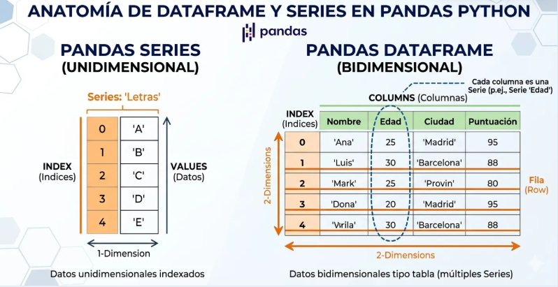
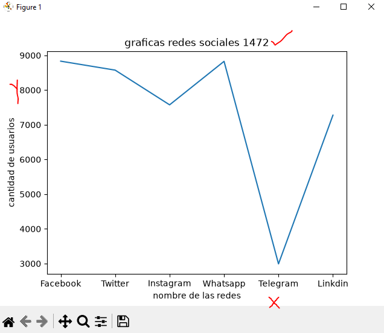
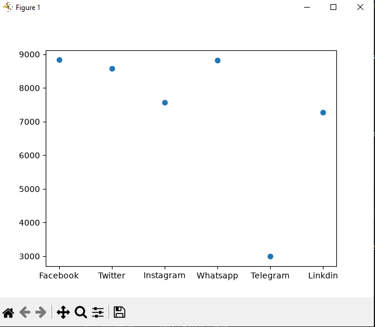
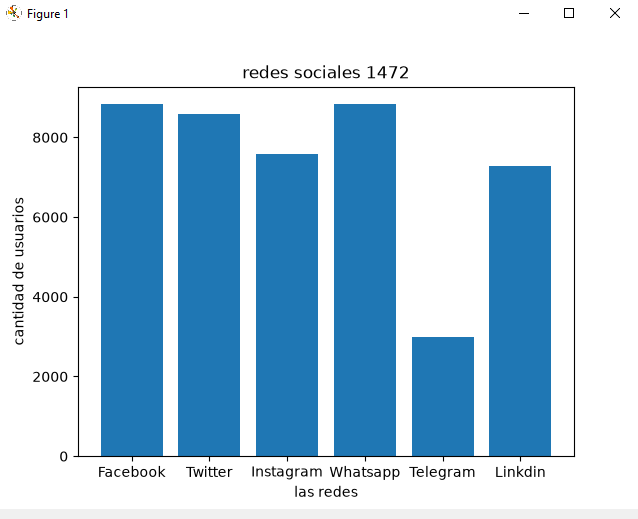
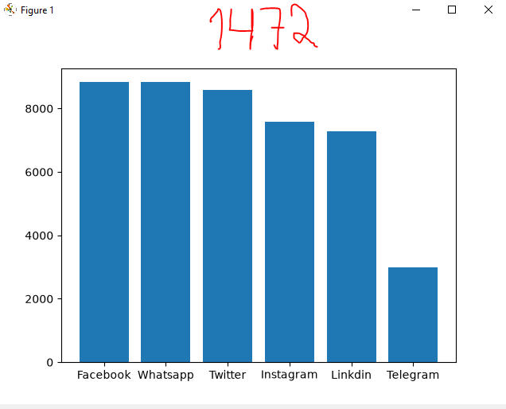
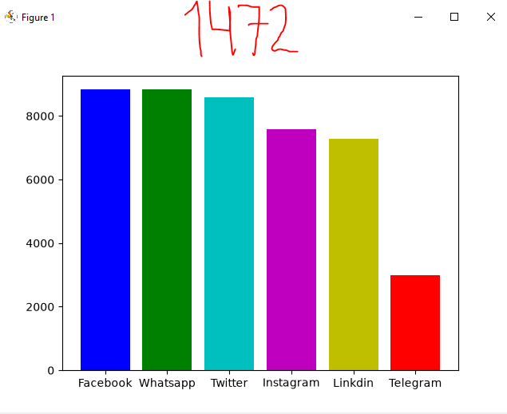
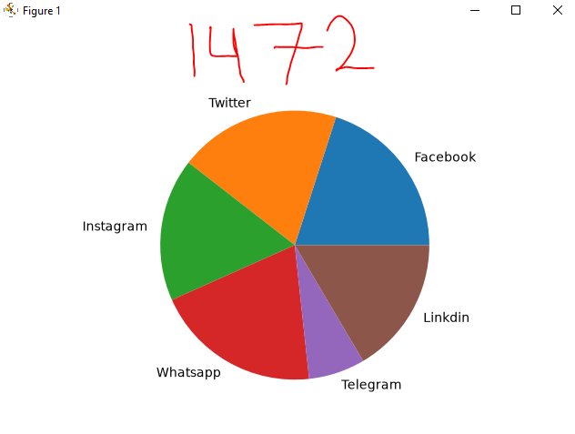

## dataframe o marco de datos pandas

## redes socialesmas a nivel mundial

## grafica lineal de redes sociales

## grafica puntual

## grafica de barras de redes sociales

## grafica de barras del mas grande al chico descendente

## coloreamosla grafica

## grafica de pastel o pie

